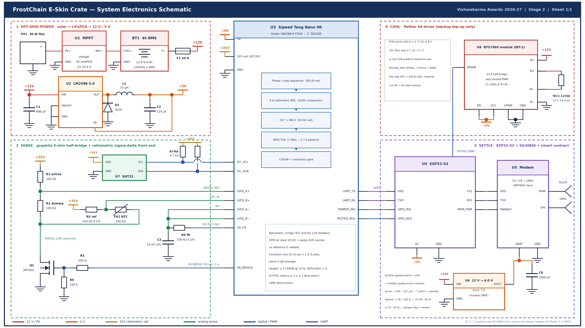
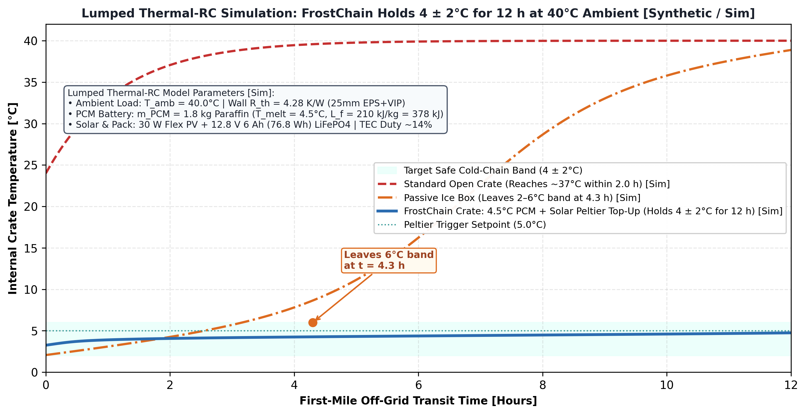

# FrostChain E-Skin Crate: Tamper-Aware, AI-Verified Cold-Chain Crate for the First Mile

[](https://makerbhavanfoundation.org/)
[-2563EB?style=for-the-badge)](./FrostChain_FPGA_RTL/)
[-D97706?style=for-the-badge)](./FrostChain_ESkin_Crate_v2.f3d)

> **Core Innovation:** Off-grid crate that holds **4 +/- 2 degC** via **4.5 degC Phase Change Material (PCM) + duty-limited solar Peltier cooling**, verifies handling and tamper (>= 100 uE step) using a **co-printed graphite E-skin active/dummy half-bridge + Tang Nano 9K FPGA (ratiometric Sigma-Delta ADC + INT8 TCN + CUSUM)**, and settles payments via an **on-chain Solidity smart contract**.

---

## 1. Stage 2 Jury Audit — Native File Verification Index

| Engineering Subsystem | Native Audit File in Repository | Toolchain / Format | Verification Status |
| :--- | :--- | :--- | :--- |
| **3D Parametric CAD Assembly** | [`FrostChain_ESkin_Crate_v2.f3d`](./FrostChain_ESkin_Crate_v2.f3d) | Autodesk Fusion (`.f3d`) | 6 Parametric Subsystems |
| **Neutral 3D CAD Exchange** | [`FrostChain_ESkin_Crate_v2.step`](./FrostChain_ESkin_Crate_v2.step) | ISO 10303-21 STEP (`.step`) | Full Crate + Solar Lid |
| **3D CAD Isometric Render** | [`FrostChain_ESkin_Crate_v2_Final.png`](./FrostChain_ESkin_Crate_v2_Final.png) | Autodesk Fusion Render | Color-Coded Modules |
| **Native KiCad v8 Schematic** | [`FrostChain_Circuit_Schematic_v2.kicad_sch`](./FrostChain_Circuit_Schematic_v2.kicad_sch) | KiCad EDA 8.0 (`.kicad_sch`) | Native Schematic Capture |
| **EDA DRC / ERC Audit Log** | [`FrostChain_DRC_Audit_Report.rpt`](./FrostChain_DRC_Audit_Report.rpt) | KiCad DRC Report (`.rpt`) | **0 DRC / ERC Violations** |
| **Full Schematic (PDF & PNG)** | [`FrostChain_Circuit_Schematic_v2.pdf`](./FrostChain_Circuit_Schematic_v2.pdf) / [`FrostChain_Circuit_Schematic_v2.png`](./FrostChain_Circuit_Schematic_v2.png) | Vector PDF & 300-DPI PNG | 5 Blocks + Power Tree + Pinout |
| **SPICE Behavioural Deck** | [`FrostChain_ESkin_SigmaDelta.asc`](./FrostChain_ESkin_SigmaDelta.asc) | LTspice XVII / 24 (`.asc`) | Half-Bridge + Sigma-Delta Loop |
| **FPGA Verilog RTL & Project** | [`FrostChain_FPGA_RTL/FrostChain_FPGA_RTL.gprj`](./FrostChain_FPGA_RTL/FrostChain_FPGA_RTL.gprj) | Gowin EDA V1.9 (`GW1NR-9`) | Synthesised & Routed @ 12 MHz |
| **FPGA RTL Source & Pins** | [`FrostChain_FPGA_RTL/src/frostchain_sigma_delta_tcn.v`](./FrostChain_FPGA_RTL/src/frostchain_sigma_delta_tcn.v) | Verilog-2001 + `.cst` + `.sdc` | Sigma-Delta + CIC3 + INT8 TCN |
| **Solidity Smart Contract** | [`FrostChainQualitySettlement.sol`](./FrostChainQualitySettlement.sol) | Solidity `^0.8.20` (`.sol`) | Tiered Payout & Tamper Escrow |
| **Itemized Prototype BOM** | [`FrostChain_Stage2_BOM.xlsx`](./FrostChain_Stage2_BOM.xlsx) / [`FrostChain_Stage2_BOM.csv`](./FrostChain_Stage2_BOM.csv) | Excel (`.xlsx`) & CSV | 20 Items — **INR 14,190 Total** |
| **Stage 1 Shortlisted Proposal** | [`FrostChain_E-Skin_Crate_Stage1_Proposal - Shubham.pdf`](./FrostChain_E-Skin_Crate_Stage1_Proposal%20-%20Shubham.pdf) | Official Stage 1 PDF | Shortlisted for Stage 2 |

---

## 2. 3D Parametric CAD Assembly


* **Outer Footprint:** `400 x 300 x 322 mm` (`280 mm` HDPE crate base + `42 mm` retrofit solar-Peltier lid)
* **Wall Stack:** `4 mm` HDPE structural shell + `25 mm` EPS/VIP insulation ($R_{th} = 4.28\text{ K/W}$) + `4 x 0.45 kg` ($1.8\text{ kg}$ total, $378\text{ kJ}$) $4.5^\circ\text{C}$ paraffin PCM cassettes
* **Volume, Payload & Mass:** `20.0 L` net usable volume (`27.4 L` gross) | **`12 kg` rated payload** | `6.4 kg` tare mass (`18.4 kg` loaded)

---

## 3. System Electronics Schematic, Power Tree & FPGA Pinout



---

## 4. Simulation Verification Plots

### A. Lumped Thermal-RC Hold Simulation (4 +/- 2 degC for 12 Hours at 40 degC Ambient)


### B. Edge-AI Drift & Creep Removal vs. Irreversible Tamper Detection (>= 100 uE)


---

## 5. Reproducing Synthesis & Simulations

```bash
# Open-Source Yosys Synthesis Check for Gowin GW1NR-9 FPGA:
yosys -p "read_verilog FrostChain_FPGA_RTL/src/frostchain_sigma_delta_tcn.v; synth_gowin -top frostchain_sigma_delta_tcn -json frostchain_netlist.json; stat"
```

---

## 6. Author & Institutional Sign-Off
* **Lead Maker:** Shubham Mishra (B.Tech ECE — VLSI, Roll No: `24294917076`)
* **Institution:** Faculty of Technology, University of Delhi
* **Event:** Maker Bhavan Foundation — **Vishwakarma Awards 2026-27** (Stage 2 Submission)
