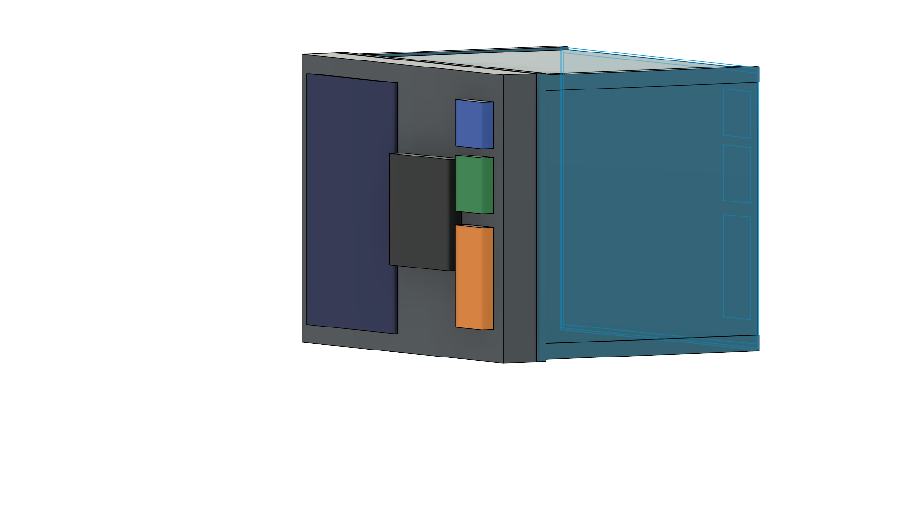
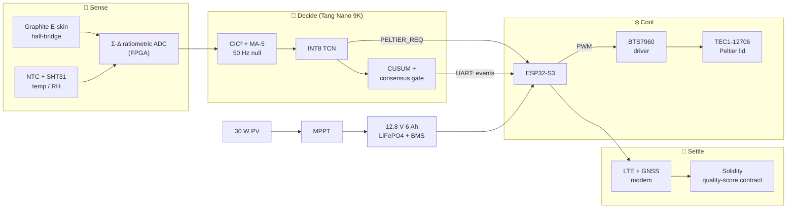
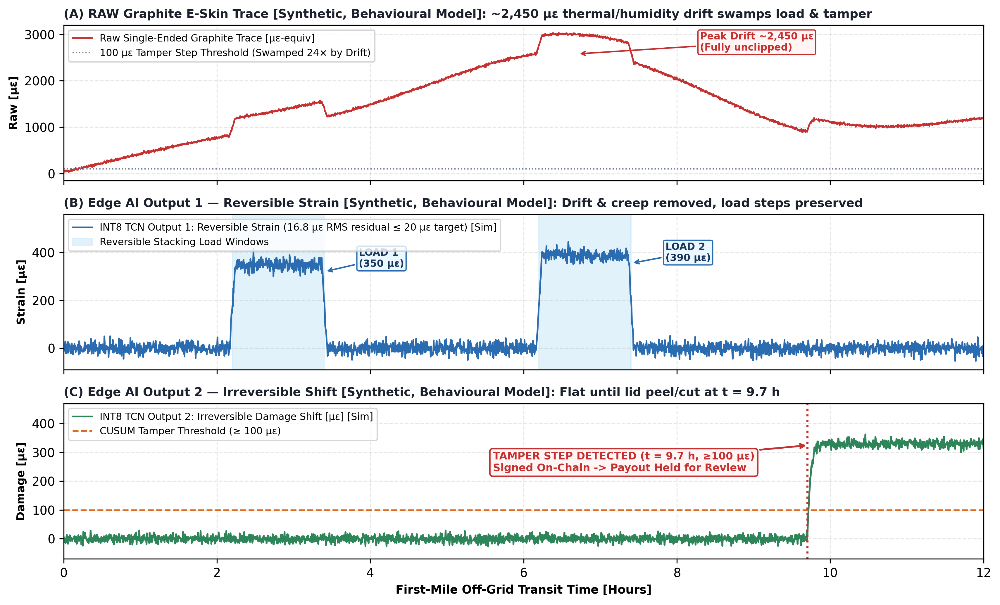

<div align="center">

# ❄️ FrostChain E-Skin Crate

### A tamper-aware, AI-verified cold-chain crate for the first mile

*PCM + solar-Peltier cooling · printed graphite E-skin · FPGA ratiometric Σ-Δ ADC · INT8 edge AI · signed on-chain quality scoring*


**Application ID:** `[APPLICATION ID]` · **Team ID:** `[TEAM ID]` · **Track:** `[TRACK]`



</div>

---

## 📑 Contents

1. [The problem](#-the-problem)
2. [The solution](#-the-solution)
3. [Simulation results](#-simulation-results)
4. [Hardware](#-hardware)
5. [Bill of materials](#-bill-of-materials)
6. [Settlement logic](#-settlement-logic)
7. [Safety](#-safety)
8. [Repository map](#-repository-map)
9. [Project status](#-project-status)
10. [Opening and reproducing](#-opening-and-reproducing)
11. [Team](#-team) · [License](#-license)

---

## 🍓 The problem

Fruit and vegetables are lost between the farm gate and the collection centre because no low-cost, off-grid crate both **holds produce near 4 °C** and **produces tamper-proof evidence** of its temperature and handling history. Without that evidence, quality disputes are settled by haggling, and the farmer is underpaid.

> Official post-harvest loss estimates for India (ICAR-CIPHET 2015): fruits 6.7–15.9 %, vegetables 4.6–12.4 %.

**Who it is for:** smallholder farmers and FPOs, first-mile aggregators, buyers and retailers, and berry, dairy or pharma shippers who need audited cold-chain proof.

## 🧊 The solution

One crate, four layers. Each layer feeds the next, and the AI sits where it turns cheap parts into trustworthy data.

| Layer | What it does | Key parts |
|---|---|---|
| ❄️ **Cool** | PCM packs act as a passive thermal battery; a solar Peltier lid tops up only when the interior reaches 5 °C | 4 × 0.45 kg 4.5 °C paraffin PCM, TEC1-12706, 30 W PV, LiFePO4 |
| 📡 **Sense** | A printed graphite active/dummy half-bridge on the lid seal and walls senses strain, rough handling, lid opening and tamper. The half-bridge cancels common-mode thermal/humidity drift | Graphite tape, Verilog Σ-Δ ADC on Tang Nano 9K |
| 🧠 **Decide** | A fixed-point INT8 TCN removes residual drift and creep and separates reversible load from irreversible steps. A CUSUM + consensus gate suppresses false alarms | ~1.7 k parameters, 1 time-multiplexed MAC |
| 🔗 **Settle** | ECDSA-signed events and GPS are pushed to a Solidity quality-score contract that decides the payout | ESP32-S3, SIM7600-class LTE + GNSS modem |



**Why graphite?** Printed graphite tape costs almost nothing but is unusable raw: its resistance drifts with temperature, humidity and creep by thousands of µε. The half-bridge plus a tiny INT8 network makes it trustworthy, so integrity sensing costs almost nothing.

## 📊 Simulation results

> ⚠️ **All results below are simulation or synthetic behavioural-model outputs.** They will be replaced with measured data from the prototype in later stages.

### Thermal hold, lumped RC model


| Parameter | Value |
|---|---|
| Ambient | 40 °C |
| Wall thermal resistance | 4.28 K/W (25 mm EPS + VIP) |
| PCM | 1.8 kg paraffin, 4.5 °C melt, 210 kJ/kg (378 kJ) |
| Power | 30 W flexible PV, 12.8 V 6 Ah (76.8 Wh) LiFePO4 |
| TEC duty | ~14 % |

| Case | Result (simulated) |
|---|---|
| Open crate in sun | Reaches ~37 °C within 2 h |
| Passive ice box | Leaves the 2-6 °C band at 4.3 h |
| **FrostChain** | **Holds 4 ± 2 °C for 12 h at 40 °C ambient** |

### Drift vs. tamper, edge-AI separation



| Panel | What it shows |
|---|---|
| **A** | Raw single-ended trace: ~2,450 µε of drift swamps the 100 µε tamper step by about 24× |
| **B** | INT8 TCN output 1, reversible strain: drift and creep removed, both load events preserved, **16.8 µε RMS residual** (target ≤ 20 µε) |
| **C** | INT8 TCN output 2, irreversible shift: flat until the lid-seal peel/cut at t = 9.7 h, then a persistent step crosses the 100 µε CUSUM threshold, **signed on-chain, payout held for review** |

### Design targets

| Metric | Target |
|---|---|
| Hold 4 ± 2 °C at 40 °C ambient | ≥ 8 h (simulated 12 h) |
| ADC resolution at 10 Hz | ≥ 13 ENOB (measured), ≥ 15 ENOB (sim) |
| INT8 vs FP32 | within 1 % |
| Residual after correction | ≤ 20 µε RMS |
| Latency | ≤ 2 s |
| False alarms | ≤ 1 per 1000 device-hours |
| Detectable tamper step | ≥ 100 µε-equivalent |
| Bridge excitation | 20 ms per 1 s (2 % duty, ~5 µW average) |

## 🔧 Hardware

<table>
<tr>
<td width="50%" valign="top">

**Mechanical** (`01_mechanical/`)
- Crate: 400 × 300 × 280 mm food-grade HDPE with a 25 mm EPS/VIP liner
- 4 PCM packs, 0.45 kg each
- Solar Peltier lid with Al 6061 cold/hot heatsinks and a 12 V fan
- E-skin tape on the lid seal and walls

</td>
<td width="50%" valign="top">

**Electronics** (`02_electronics/`)
- Tang Nano 9K (GW1NR-9): Σ-Δ ADC, CIC/MA, INT8 TCN, CUSUM
- ESP32-S3: Peltier PWM, thermal cut-off, signing, uplink
- SIM7600-class LTE + GNSS modem
- Power: PV → MPPT → 4S LiFePO4 (12.8 V, 6 Ah) → F1 10 A → 12 V / 5 V / 4.0 V rails

</td>
</tr>
</table>


*The schematic has five blocks: 1 Off-grid power, 2 Sense, 3 Decide, 4 Cool, 5 Settle. Values are design targets for SPICE and are not final.*

## 🧾 Bill of materials

Full itemised BOM: [`04_bom/FrostChain_Stage2_BOM.xlsx`](04_bom/FrostChain_Stage2_BOM.xlsx) (also `.csv`).

| Subsystem | Cost (₹) |
|---|---:|
| Telemetry & FPGA compute | 4,480 |
| Power & solar | 4,585 |
| Crate & PCM thermal liner | 2,600 |
| E-skin, PCB & passives | 1,485 |
| Peltier & heatsinks | 1,050 |
| **Total (Stage 2 prototype)** | **14,200** |

Most parts are sourced domestically or locally, with 1-5 day lead times. The Tang Nano 9K is the main imported item.

## ⚖️ Settlement logic

```
Quality Score = 100 − Σ(T_actual − T_target)·t − handling penalty
```

| Quality Score | Payout |
|---|---|
| > 90 | 100 % |
| 70 – 90 | 80 % |
| ≤ 70 | 50 % base |
| Tamper flag raised | Held for review |

Events are ECDSA-signed on the ESP32-S3 with GPS and anchored to a Solidity smart contract, so neither farmer nor buyer can alter the temperature or handling history.

## 🛡️ Safety

| Risk | Mitigation |
|---|---|
| Battery over-current / over-temperature | 4S BMS cut-off and 10 A fuse |
| Peltier hot-side overheat or fan stall | Duty-limited PWM, hot-side NTC cut-off, fan-stall lockout |
| Broken or peeled sensor | Separate FAULT state, never reported as tamper |
| False tamper alarm | Network posterior + CUSUM persistence + healthy dummy trace |
| Firmware hang / corrupted records | Watchdog, saturating fixed-point arithmetic, CRC on records |
| No network coverage | Signed events stored and forwarded |
| Electrical hazard | Low-voltage (12 V) design |

## 🗂️ Repository map

```
frostchain-eskin-crate/
├── 01_mechanical/        Fusion 360 model (.f3d), STEP, renders, FEA
├── 02_electronics/       KiCad project, ERC/DRC reports, schematic exports, LTspice model
├── 03_models_and_plots/  Simulation plots and the scripts that generate them
├── 04_bom/               Itemised BOM (.xlsx and .csv)
└── 05_docs/              Stage 1 proposal, evidence photos
```

## 🚦 Project status

| Item | Status | Where |
|---|---|---|
| Crate + electronics-bay CAD (Fusion 360 / STEP) | ✅ Modelled (v2) | `01_mechanical/` |
| Thermal-RC hold simulation | ✅ Synthetic / sim | `03_models_and_plots/` |
| AI drift / tamper separation | ✅ Synthetic behavioural model | `03_models_and_plots/` |
| System schematic | ✅ Design-target diagram v2 | `02_electronics/exports/` |
| Itemised BOM | ✅ 20 line items | `04_bom/` |
| Half-bridge drift model (LTspice) | 🟡 Bridge + integrator cap; Σ-Δ loop model pending | `02_electronics/spice/` |
| FEA | ⬜ Not yet added | `01_mechanical/fea/` |
| KiCad project + ERC/DRC | ⬜ Not yet added | `02_electronics/kicad/`, `drc/` |
| Verilog RTL + golden model | ⬜ Planned | n/a |
| Prototype build and measured data | ⬜ Stage 3 | n/a |

**Roadmap** (from the Stage 1 plan):
- [x] Phase 1: behavioural and thermal simulation
- [ ] Phase 2: Verilog Σ-Δ front end, CIC³, MA-5, phase/chop sequencer; build E-skin tape pairs and the PCM/Peltier crate
- [ ] Phase 3: INT8 TCN, CUSUM guard, ESP32-S3 uplink, Solidity contract on a testnet
- [ ] Phase 4: heat/humidity cycling, load and peel/cut tamper tests, live end-to-end demo (crate → tamper event → on-chain payout change)

## ▶️ Opening and reproducing

| File | Open with |
|---|---|
| `.f3d` | Autodesk Fusion 360 |
| `.step` | Any CAD package |
| `.asc` | LTspice |
| `.kicad_*` | KiCad `[VERSION]` |

Plot reproduction: `[RUN COMMANDS, to be added with the scripts in 03_models_and_plots/scripts/]`

**Demo and videos (external links only):** `[LINK]`

## 👥 Team

| Name | Role |
|---|---|
| `[NAME]` | `[ROLE]` |

Faculty mentor: `[NAME, DEPARTMENT]`

## 📄 License

MIT, see [`LICENSE`](LICENSE).

---

<div align="center"><sub>FrostChain E-Skin Crate · Vishwakarma Awards 2026-27 · Stage 2</sub></div>
